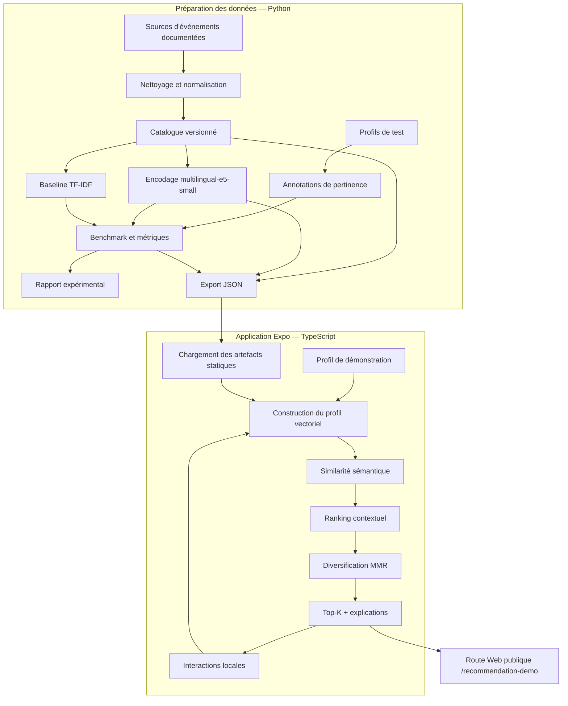

# Rivald'event — Plan directeur d'implémentation du système de recommandation ML

> **Document de référence du projet — Source de vérité**  
> Version : `1.0`  
> Statut : plan d'implémentation à exécuter  
> Dépôt cible : `RivaldoDolce/rivaldevent`, branche de travail issue de `develop`  
> Route de démonstration visée : `/recommendation-demo`

---

## 0. Règle d'utilisation de ce document

Ce document définit le périmètre, les décisions d'architecture, la méthodologie ML, les contrats de données, les étapes d'implémentation, les critères de validation et le scénario de démonstration du système de recommandation Rivald'event.

Il doit être traité comme la **source de vérité du chantier** :

1. Toute implémentation doit respecter les décisions explicites de ce document.
2. Une modification de périmètre ou d'architecture doit être consignée dans la section [Décisions d'architecture](#7-décisions-darchitecture) avant d'être appliquée.
3. Les résultats expérimentaux doivent provenir du code et des données effectivement exécutés. Il est interdit de remplir manuellement des métriques pour rendre le projet plus convaincant.
4. Les données fictives, les profils simulés et les annotations manuelles doivent être clairement identifiés comme tels.
5. Une phase n'est terminée que lorsque ses critères de sortie sont vérifiés. La simple création des fichiers ne constitue pas une implémentation terminée.

Le document sera mis à jour au fil du projet, mais les changements doivent préserver l'historique des décisions importantes et la reproductibilité des expériences.

---

# 1. Contexte et état initial du produit

## 1.1 Contexte de Rivald'event

Rivald'event est une application de découverte et de réservation d'événements pensée pour le marché camerounais. Le produit couvre notamment la découverte d'événements, les lieux, les billets, les organisateurs et des parcours d'achat qui pourront, à terme, s'appuyer sur les moyens de paiement locaux.

La branche `develop` dispose déjà d'une base applicative conséquente :

- application mobile/web avec Expo, React Native, Expo Router et TypeScript ;
- interface organisée autour des expériences client et vendeur ;
- composants de découverte d'événements et de lieux ;
- services et données de démonstration déjà présents ;
- intégration prévue avec Supabase et Clerk pour certaines fonctions du produit ;
- configuration Expo Web avec sortie statique déjà déclarée.

Cependant, l'audit de la branche a mis en évidence une distinction importante entre la surface fonctionnelle de l'application et la maturité réelle de ses flux métier : plusieurs opérations sont encore simulées, notamment certaines opérations vendeur, le paiement et le scan des billets. Les données de démonstration ne constituent pas un historique réel de réservations ou de ventes.

**Conséquence :** le projet ML ne doit pas supposer l'existence d'un historique fiable de clics, de réservations, de transactions ou de fréquentation. Il ne doit donc pas prétendre apprendre le comportement de vrais clients ni démontrer un gain commercial réel.

## 1.2 Pourquoi ajouter un système de recommandation ?

Un catalogue d'événements ne résout pas à lui seul le problème de découverte. Un utilisateur peut être confronté à beaucoup d'événements, mais ne pas savoir lesquels correspondent réellement à ses intérêts, à sa localisation, à son budget ou à ses disponibilités.

Le système de recommandation vise à répondre à cette question :

> **Parmi les événements disponibles dans le catalogue, lesquels sont les plus pertinents pour un utilisateur donné, compte tenu de ses intérêts et de son contexte ?**

Cette fonctionnalité apporte une dimension intelligente au produit. Elle transforme Rivald'event d'une simple interface de consultation en un système capable de personnaliser et de hiérarchiser l'information.

## 1.3 Pourquoi le projet est pertinent pour une candidature en Master ML/IA

Le projet doit démontrer davantage que la capacité à appeler une API de modèle ou à afficher une liste triée. Il doit prouver que son auteur sait conduire une démarche de machine learning appliquée :

- formuler un problème et une question de recherche ;
- construire et documenter un jeu de données ;
- définir des labels et un protocole d'évaluation ;
- sélectionner une représentation sémantique adaptée à des textes multilingues ;
- concevoir des baselines comparables ;
- construire une chaîne de ranking explicable ;
- mesurer la pertinence et la diversité ;
- interpréter les résultats et leurs limites ;
- intégrer un artefact ML dans une application logicielle réelle ;
- rendre le système démontrable et reproductible.

La qualité scientifique de l'évaluation sera plus importante que le nombre de fonctionnalités ajoutées à l'application.

---

# 2. Présentation du projet ML

## 2.1 Nom du projet

**Rivald'event — Context-Aware Multilingual Event Recommender**

Nom descriptif en français : **système de recommandation événementielle multilingue et contextuel**.

## 2.2 Problème ML traité

Le problème est un problème de **classement personnalisé (personalized ranking)** sur un catalogue d'événements.

Pour un profil utilisateur `u` et un ensemble candidat d'événements `E`, le système doit produire une liste ordonnée :

\[
R(u) = [e_1, e_2, \ldots, e_k]
\]

où les événements les plus pertinents apparaissent en tête, sans produire une liste excessivement répétitive.

Le classement s'appuie sur trois familles de signaux :

1. **Contenu :** titre, description, catégorie, mots-clés, lieu et autres informations descriptives.
2. **Préférences :** catégories recherchées, ville, budget et événements de référence associés au profil.
3. **Contexte :** compatibilité géographique, financière et temporelle.

La version initiale utilisera des représentations sémantiques pré-calculées et des règles de ranking configurables. Elle ne reposera pas sur un apprentissage collaboratif à partir de transactions qui n'existent pas dans le jeu de données actuel.

## 2.3 Question de recherche

Question de recherche principale, à conserver dans le rapport :

> **Can multilingual semantic representations improve context-aware event recommendation under sparse-data and cold-start conditions compared with traditional content-based recommendation methods?**

Traduction :

> Les représentations sémantiques multilingues améliorent-elles la recommandation événementielle contextuelle en situation de données rares et de démarrage à froid, par rapport aux méthodes traditionnelles fondées sur le contenu ?

## 2.4 Hypothèses à examiner

Les hypothèses sont des questions expérimentales, pas des résultats acquis.

- **H1 — Représentation sémantique :** les embeddings multilingues peuvent mieux rapprocher des événements sémantiquement similaires que la seule similarité lexicale TF-IDF, notamment lorsque les textes utilisent des formulations différentes.
- **H2 — Contexte :** l'ajout de signaux explicites comme la ville, le budget et la catégorie peut améliorer le classement par rapport à la similarité sémantique seule.
- **H3 — Diversité :** une étape de diversification MMR peut réduire la redondance des listes recommandées, avec un éventuel compromis sur la pertinence individuelle des premiers résultats.
- **H4 — Cold start :** un système fondé sur le contenu et sur un profil construit à partir de préférences déclarées peut produire des recommandations utiles sans historique de transactions.

Les résultats pourront confirmer, nuancer ou rejeter ces hypothèses. Un résultat négatif correctement mesuré reste un résultat scientifique valable.

## 2.5 Contribution attendue

À la fin du projet, la contribution doit être démontrable sur quatre plans :

| Axe | Contribution attendue | Preuve à fournir |
|---|---|---|
| ML/NLP | Encodage multilingue des descriptions d'événements et représentation vectorielle des profils | Pipeline Python, configuration du modèle, artefacts versionnés |
| Recommandation | Ranking combinant pertinence sémantique, contexte et diversité | Moteur TypeScript, formules et tests unitaires |
| Évaluation | Comparaison objective de plusieurs approches sur les mêmes profils et événements | Jeu d'annotations, scripts de benchmark, rapport et métriques calculées |
| Ingénierie | Intégration du résultat ML dans une application Expo consultable en ligne | Route de démonstration, dépôt GitHub, build Web et vidéo de secours |

---

# 3. Objectifs et critères de réussite

## 3.1 Objectif principal

Construire un système de recommandation contextuel capable de classer les événements d'un catalogue Rivald'event selon un profil utilisateur, puis démontrer son fonctionnement dans une interface Web interactive et publiquement accessible.

## 3.2 Objectifs spécifiques

1. Constituer un catalogue expérimental propre, documenté et adapté au contexte camerounais.
2. Créer des profils de test représentatifs de plusieurs intentions de découverte.
3. Produire des jugements de pertinence exploitables pour l'évaluation.
4. Implémenter une baseline lexicale TF-IDF.
5. Implémenter une représentation sémantique avec `intfloat/multilingual-e5-small`.
6. Ajouter un ranking contextuel configurable.
7. Ajouter une diversification MMR.
8. Mesurer la qualité des approches avec des métriques adaptées au ranking.
9. Exporter les événements, embeddings et résultats sous forme d'artefacts statiques.
10. Intégrer un moteur TypeScript autonome dans le dépôt Rivald'event.
11. Fournir une route de démonstration accessible sans authentification.
12. Publier un lien Web, une vidéo de démonstration et un rapport technique exploitable dans un CV.

## 3.3 Définition de réussite

Le projet est considéré comme réussi lorsque :

- le pipeline ML s'exécute depuis un environnement documenté ;
- les expériences sont reproductibles avec une configuration versionnée ;
- les méthodes sont évaluées sur les mêmes profils et le même catalogue ;
- les métriques sont calculées automatiquement ;
- les artefacts générés sont consommés par le moteur TypeScript ;
- le moteur fonctionne sans appel à un service ML distant ;
- la démonstration est accessible par URL sans création de compte ;
- les interactions de démonstration modifient réellement le classement ;
- les données fictives et les limites de l'évaluation sont explicitement signalées ;
- le dépôt et le rapport expliquent clairement ce qui a été implémenté et ce qui reste futur.

---

# 4. Périmètre : ce qui sera construit et ce qui ne le sera pas

## 4.1 Inclus dans la première version (MVP de recherche)

- Catalogue statique d'événements documentés.
- Profils de démonstration fictifs avec préférences explicites.
- Annotations manuelles de pertinence.
- Prétraitement du contenu textuel.
- Baseline TF-IDF.
- Embeddings multilingues E5 calculés en Python.
- Profil vectoriel calculé par agrégation pondérée des embeddings des événements de référence.
- Classement contextuel par catégorie, ville, budget et date.
- Diversification MMR.
- Métriques de ranking et de diversité.
- Export JSON des artefacts.
- Moteur TypeScript pur et testable.
- Interface de démonstration Expo Web.
- Interactions locales : favori, désintérêt, modification de préférences, réinitialisation.
- Rapport d'expérimentation et vidéo de démonstration.

## 4.2 Explicitement hors périmètre

Les éléments suivants ne doivent pas être ajoutés à la première version, sauf décision formelle de changement de périmètre :

- publication de l'application mobile sur Google Play ou App Store ;
- intégration d'un vrai prestataire de paiement ;
- collecte de transactions réelles ;
- authentification pour la démonstration ;
- backend ML ou API de recommandation distante ;
- Supabase, pgvector ou vector database pour le moteur de démonstration ;
- base SQLite obligatoire pour les interactions de la démo ;
- chargement du modèle E5 dans le navigateur ou sur le mobile ;
- apprentissage collaboratif fondé sur des utilisateurs réels ;
- système de prédiction des ventes ou de la demande ;
- recommandation entraînée avec des données comportementales inexistantes ;
- système de fraude ;
- refonte générale de Rivald'event ;
- reconstruction de l'application vendeur ou des flux de paiement.

## 4.3 Pourquoi ne pas faire de collaborative filtering maintenant ?

Le filtrage collaboratif exige une matrice d'interactions suffisamment informative : utilisateurs, événements consultés, clics, favoris, réservations ou achats, avec une provenance fiable.

Le dépôt contient des données simulées et ne fournit pas encore un historique de transactions pouvant servir de vérité terrain. Fabriquer artificiellement une grande matrice utilisateur-événement donnerait une impression de sophistication, mais ne démontrerait pas une capacité réelle de généralisation.

Le filtrage collaboratif est donc réservé à une version ultérieure, lorsqu'un volume suffisant d'interactions réelles et consenties sera disponible. Le projet initial sera présenté honnêtement comme un **recommandeur content-based sémantique et contextuel**, et non comme un système collaboratif entraîné.

---

# 5. Architecture cible

## 5.1 Principe général

L'architecture suit une séparation en deux environnements :

- **Python — préparation et évaluation ML :** construction du jeu de données, encodage, benchmarks, calcul des métriques et export.
- **TypeScript/Expo — exécution et démonstration :** chargement des artefacts, construction du profil, calcul du classement, diversification et affichage.

Le modèle de langage n'est pas exécuté dans l'application. Les vecteurs d'événements sont calculés hors ligne et exportés. Le runtime TypeScript effectue uniquement des opérations vectorielles légères et des calculs de ranking.

## 5.2 Schéma d'architecture



## 5.3 Structure des dossiers cible

La structure ci-dessous est la structure cible du chantier. Les chemins marqués `NOUVEAU` sont à créer. Les fichiers générés ne doivent pas être remplis manuellement.

```text
rivaldevent/
│
├── app/
│   └── recommendation-demo.tsx               # NOUVEAU — Route publique
│
├── components/
│   └── recommendations/                     # NOUVEAU
│       ├── RecommendationsDemoScreen.tsx
│       ├── DemoProfileSelector.tsx
│       ├── RecommendationCard.tsx
│       ├── RecommendationExplanation.tsx
│       └── ModelComparisonPanel.tsx
│
├── data/
│   └── recommendations/                     # NOUVEAU
│       ├── demo-profiles.ts
│       └── generated/                        # Artefacts créés par Python
│           ├── events.v1.json
│           ├── embeddings.v1.json
│           └── benchmark.v1.json
│
├── hooks/
│   └── useRecommendationDemo.ts              # NOUVEAU
│
├── services/
│   └── recommendations/                     # NOUVEAU
│       ├── recommendation-engine.ts
│       ├── profile-builder.ts
│       ├── similarity.ts
│       ├── contextual-ranking.ts
│       ├── mmr-reranker.ts
│       └── explanations.ts
│
├── types/
│   └── recommendations.ts                    # NOUVEAU
│
├── ml/                                       # NOUVEAU — Projet Python
│   ├── README.md
│   ├── pyproject.toml
│   ├── configs/
│   │   └── recommender.yaml
│   ├── data/
│   │   ├── raw/
│   │   │   ├── events.csv
│   │   │   └── README.md
│   │   ├── annotations/
│   │   │   └── relevance.csv
│   │   └── processed/
│   ├── scripts/
│   │   ├── build_dataset.py
│   │   ├── build_embeddings.py
│   │   ├── run_benchmark.py
│   │   └── export_runtime_assets.py
│   ├── src/
│   │   └── rivaldevent_ml/
│   │       ├── __init__.py
│   │       ├── dataset.py
│   │       ├── embeddings.py
│   │       ├── recommenders.py
│   │       ├── metrics.py
│   │       └── export.py
│   ├── tests/
│   │   ├── test_dataset.py
│   │   ├── test_recommenders.py
│   │   └── test_metrics.py
│   └── reports/
│       ├── benchmark.md
│       └── figures/
│
└── docs/
    └── ml-recommender/
        └── IMPLEMENTATION_PLAN.md             # Copie de référence de ce guide
```

### Règles d'intégration dans le dépôt existant

- Ne pas créer un second répertoire `src/` à la racine du projet Expo.
- Conserver les conventions de l'application : `app/`, `components/`, `hooks/`, `services/`, `types/` et `data/`.
- Le répertoire `ml/` est autonome et possède son propre environnement Python.
- Les artefacts exportés sont placés dans `data/recommendations/generated/` pour être importables par Expo.
- La route `app/recommendation-demo.tsx` se trouve à la racine de `app/`, et non dans un groupe d'authentification.
- Expo Router découvre automatiquement les fichiers de route. Ne modifier `app/_layout.tsx` que si une option de navigation spécifique est réellement nécessaire.
- La route de démonstration ne doit pas importer les hooks d'authentification ni dépendre du parcours d'achat.

---

# 6. Méthodologie ML et protocole expérimental

## 6.1 Stratégie de données

Le jeu de données est le risque scientifique principal du projet. Un modèle sophistiqué ne compensera pas un catalogue peu fiable ou des labels incohérents.

### Volume cible

- Première version exploitable : environ 80 à 120 événements vérifiés et bien décrits.
- Cible souhaitée après enrichissement : environ 150 à 300 événements.
- Profils de test : commencer avec 8 à 12 profils construits et documentés ; viser 12 à 20 lorsque le volume d'annotations le permet.

La qualité du contenu prime sur le volume. Ne pas remplir le catalogue avec des événements répétitifs ou inventés uniquement pour atteindre un nombre élevé.

### Couverture souhaitée

Rechercher une diversité raisonnable de :

- villes : Douala, Yaoundé, Buea, Limbe, et d'autres villes lorsque des informations fiables sont accessibles ;
- catégories : musique, culture, art, technologie, entrepreneuriat, conférences, sport, éducation, divertissement ;
- langues : français et anglais, en conservant la langue originale du texte ;
- budgets : gratuit, entrée à bas prix, prix intermédiaire et prix supérieur ;
- formats : conférence, concert, festival, spectacle, atelier, rencontre, exposition.

Cette liste décrit les dimensions à couvrir. Elle ne constitue pas une affirmation sur l'existence actuelle d'événements précis.

### Sources et traçabilité

Chaque événement doit avoir une provenance identifiable : source publique, page d'organisateur, site officiel ou donnée explicitement créée pour une démonstration.

Pour chaque ligne, conserver autant que possible :

- `source_type` : `official`, `public_listing` ou `demo_fixture` ;
- `source_url` : URL de la source, si applicable ;
- `collected_at` : date de collecte ;
- `verified_at` : date de dernière vérification ;
- `is_demo` : booléen indiquant si l'entrée est fictive ou illustrative.

Respecter les conditions d'utilisation et les droits associés aux contenus collectés. Ne pas recopier massivement des descriptions protégées. Pour les données créées manuellement, le documenter.

Un événement expiré ou dont les informations sont manifestement incohérentes ne doit pas être présenté comme une offre actuellement réservable. Le jeu de données de recherche et les événements affichés dans la démo peuvent être historiques ou fictifs, mais leur statut doit être visible.

## 6.2 Schéma du catalogue brut

Fichier : `ml/data/raw/events.csv`

Colonnes minimales recommandées :

```csv
event_id,title,description,category,city,venue,price_min,price_max,currency,start_at,end_at,language,tags,source_type,source_url,collected_at,verified_at,is_demo
```

Contraintes :

- `event_id` est stable et unique ;
- les dates sont stockées au format ISO 8601 ;
- la devise locale est explicite (`XAF`) ;
- les prix inconnus restent nuls et ne sont pas transformés en zéro ;
- `price_min` ne peut pas être supérieur à `price_max` ;
- les catégories utilisent un vocabulaire contrôlé ;
- les textes vides sont signalés et traités explicitement ;
- les accents, caractères français et textes anglais sont conservés ;
- aucune disponibilité de billet n'est déduite de la seule présence d'un événement dans le catalogue.

## 6.3 Profils de démonstration

Les profils sont des personas fictifs utilisés pour tester le classement, pas des comptes clients.

Profils de départ proposés :

| Profil | Ville de référence | Intérêts dominants | Budget indicatif |
|---|---|---|---:|
| `music_fan_douala` | Douala | Concerts, musique, festivals | 5 000–25 000 XAF |
| `tech_enthusiast_yaounde` | Yaoundé | IA, technologie, startup, conférences | 0–15 000 XAF |
| `culture_lover` | À définir selon le catalogue | Théâtre, arts, culture, festivals | À définir selon les données |

Les valeurs sont des paramètres fictifs destinés à tester les comportements du moteur. Elles ne doivent pas être décrites comme des statistiques sur les habitants d'une ville.

Chaque profil doit comporter :

- identifiant stable ;
- nom affiché et description ;
- ville de référence ;
- budget minimum et maximum ;
- catégories préférées ;
- identifiants des événements de référence (`seedEventIds`) ;
- éventuellement des contraintes temporelles.

Fichier applicatif : `data/recommendations/demo-profiles.ts`.

## 6.4 Annotations de pertinence

Fichier : `ml/data/annotations/relevance.csv`

```csv
profile_id,event_id,relevance,annotator,notes
```

Échelle graduée :

| Valeur | Signification |
|---:|---|
| 0 | Non pertinent pour le profil |
| 1 | Faiblement pertinent |
| 2 | Pertinent |
| 3 | Très pertinent |

Chaque couple profil-événement ne doit avoir qu'un label par annotateur. Les règles d'annotation doivent être écrites avant de produire les labels.

### Guide d'annotation

Évaluer la pertinence en tenant compte de :

1. adéquation avec les intérêts déclarés ;
2. adéquation avec la catégorie recherchée ;
3. compatibilité géographique ;
4. compatibilité avec le budget ;
5. cohérence temporelle.

Ne pas attribuer systématiquement une pertinence élevée à un événement simplement parce que sa description contient plusieurs mots du profil. Le jugement doit porter sur l'adéquation réelle au besoin décrit.

Lorsque c'est possible, faire annoter un sous-ensemble par une seconde personne et comparer les divergences. Si une seule personne réalise les annotations, déclarer explicitement cette limite dans le rapport. Ne pas prétendre disposer d'une vérité terrain objective : les labels sont des jugements de pertinence documentés.

Pour les métriques Precision et Recall, fixer le seuil positif à `relevance >= 2` et le documenter. NDCG exploite directement les labels gradués.

## 6.5 Prétraitement du texte

Créer une représentation textuelle cohérente de chaque événement en assemblant les champs pertinents :

```text
passage: {titre}. Catégorie: {catégorie}. Description: {description}.
Lieu: {ville}. Salle: {lieu}. Mots-clés: {tags}.
```

Principes :

- préserver les informations en français et en anglais ;
- normaliser les espaces et les champs manquants ;
- ne pas supprimer aveuglément les mots courts ou les accents ;
- ne pas répéter artificiellement un champ pour biaiser l'embedding ;
- éviter d'inclure des données non pertinentes dans le texte encodé ;
- conserver la version du prétraitement utilisée pour chaque export.

## 6.6 Modèle sémantique

Modèle de départ : `intfloat/multilingual-e5-small`.

Le modèle fournit des embeddings multilingues de dimension 384 selon la configuration retenue. Utiliser le préfixe `passage:` pour les textes d'événements.

Le pipeline doit enregistrer :

- l'identifiant exact du modèle ;
- sa révision ou son commit lorsque disponible ;
- la dimension des vecteurs ;
- la version des bibliothèques ;
- la date de génération ;
- la version du prétraitement ;
- le type de normalisation appliqué.

L'objectif n'est pas de fine-tuner le modèle au départ. Commencer par une approche zero-shot avec des embeddings pré-entraînés et évaluer son utilité dans ce domaine.

### Limite assumée du runtime

L'application ne génère pas d'embedding à partir d'un texte libre saisi par l'utilisateur. Le vecteur initial du profil est construit à partir des embeddings d'événements de référence et des interactions locales.

Les préférences structurées (catégories, ville et budget) peuvent être modifiées dans l'interface sans modèle supplémentaire. L'ajout d'une recherche libre sémantique nécessiterait un service d'encodage ou un modèle exécuté dans le client ; ce n'est pas inclus dans la première version.

## 6.7 Construction du profil vectoriel

Pour un profil donné, construire un vecteur utilisateur en agrégeant les vecteurs des événements de référence et les feedbacks de démonstration.

Forme générale :

\[
\mathbf{u} = \operatorname{normalize}\left(\sum_{i=1}^{n} w_i \mathbf{e_i}\right)
\]

Où :

- `e_i` représente l'embedding d'un événement ;
- `w_i` représente le poids associé à l'événement ;
- `normalize` applique une normalisation L2.

Poids initiaux de feedback, à traiter comme des heuristiques configurables et non comme des paramètres appris :

| Action de démonstration | Poids initial indicatif |
|---|---:|
| Consultation du détail | +1 |
| Partage | +2 |
| Favori | +3 |
| Intention de réservation simulée | +4 |
| Achat simulé | +5 |
| Désintérêt explicite | -3 |
| Impression sans interaction | 0 |

**Une impression ne doit jamais être interprétée comme un signal négatif.** Un événement non cliqué peut ne pas avoir été remarqué ou affiché correctement.

Pour limiter les effets extrêmes :

- ne pas compter plusieurs fois le même clic comme plusieurs signaux indépendants ;
- borner ou plafonner les poids cumulés par événement ;
- séparer les signaux positifs et négatifs dans le code ;
- gérer le cas où le vecteur agrégé devient nul ;
- appliquer une solution de repli documentée si le profil ne possède aucun événement de référence.

Dans la démonstration, l'intention de réservation et l'achat ne sont que des actions simulées de feedback. Elles ne sont ni envoyées à un système de paiement ni présentées comme de vraies ventes.

## 6.8 Similarité sémantique

Calculer la similarité cosinus entre le vecteur profil et chaque embedding événement :

\[
\operatorname{cos}(u,e) = \frac{u \cdot e}{\|u\|_2\|e\|_2}
\]

Normaliser les vecteurs une seule fois lorsque cela est cohérent avec les opérations suivantes et tester les cas de vecteurs nuls ou de dimension incorrecte.

La fonction doit être pure, déterministe et testée indépendamment de l'interface.

## 6.9 Ranking contextuel

Le score final combine la pertinence sémantique et les signaux contextuels :

\[
S(u,e) = w_s S_{semantic} + w_c S_{category} + w_l S_{location} + w_b S_{budget} + w_t S_{temporal}
\]

Les poids doivent être configurables dans `ml/configs/recommender.yaml` et cohérents entre les expériences Python et le runtime TypeScript.

Règles :

- les événements expirés ou invalides sont exclus des recommandations présentées comme actuelles ;
- une ville différente peut réduire le score sans nécessairement exclure l'événement ;
- un prix inconnu ne doit pas être interprété comme gratuit ;
- le chevauchement entre budget du profil et fourchette de prix de l'événement doit être calculé explicitement ;
- une catégorie préférée peut produire un bonus, mais ne doit pas neutraliser totalement la similarité sémantique ;
- les champs inconnus doivent être traités sans créer artificiellement de bonus.

Les poids initiaux sont des paramètres de départ. Leur sélection doit être faite sur l'ensemble de développement, jamais en ajustant le système jusqu'à obtenir le résultat attendu sur le jeu de test final.

## 6.10 Diversification MMR

La diversification intervient après le classement de pertinence.

La forme standard de MMR est :

\[
MMR(e) = \lambda \cdot Rel(e) - (1-\lambda) \cdot \max_{s \in Selected} Sim(e,s)
\]

Où :

- `Rel(e)` est le score de pertinence de l'événement ;
- `Sim(e,s)` mesure la similarité avec les événements déjà sélectionnés ;
- `lambda` contrôle le compromis pertinence-diversité.

Le paramètre `lambda` doit être configurable et évalué sur les données de développement. Une liste diversifiée n'est pas automatiquement meilleure : l'amélioration de diversité doit être examinée en parallèle de la pertinence.

## 6.11 Baselines à comparer

Toutes les méthodes doivent recevoir le même catalogue candidat et les mêmes profils.

| Méthode | Principe | Rôle expérimental |
|---|---|---|
| Metadata baseline | Catégorie, ville et règles explicites | Baseline simple et interprétable |
| TF-IDF | Similarité lexicale entre textes d'événements et profil de référence | Baseline content-based traditionnelle |
| E5 semantic | Similarité cosinus des embeddings E5 | Mesurer l'apport sémantique |
| E5 + context | E5 complété par ville, budget, catégorie et temporalité | Mesurer l'apport du contexte |
| E5 + context + MMR | Ranking contextuel puis diversification | Mesurer le compromis pertinence-diversité |

Une baseline de popularité ne peut être ajoutée que si une mesure de popularité réelle, documentée et comparable est disponible. Ne pas fabriquer une popularité à partir d'un nombre aléatoire ou d'un champ arbitraire.

## 6.12 Protocole d'évaluation

- Chaque méthode reçoit exactement les mêmes événements candidats.
- Les profils, les labels et les règles d'inclusion sont versionnés.
- Les paramètres sont sélectionnés sur les données de développement.
- Les résultats finaux sont calculés sur un jeu de test qui n'a pas servi au réglage des poids.
- Les résultats sont agrégés par profil, puis macro-moyennés afin qu'un profil très annoté ne domine pas les autres.
- Les seeds et les paramètres sont fixés pour assurer la reproductibilité.
- Les résultats doivent inclure le nombre de profils, d'événements et de jugements exploités.

Avec un petit nombre de profils, les métriques auront une incertitude importante. Le rapport doit afficher les effectifs et ne pas surinterpréter de faibles différences.

## 6.13 Métriques

| Métrique | Ce qu'elle mesure | Utilisation |
|---|---|---|
| Precision@K | Part des résultats du Top-K jugés pertinents | Pertinence de la liste affichée |
| Recall@K | Part des éléments pertinents retrouvés dans le Top-K | Capacité de récupération |
| NDCG@K | Qualité du classement avec labels gradués | Métrique principale de ranking |
| MRR@K | Position du premier élément pertinent | Rapidité d'accès à un résultat pertinent |
| Catalog Coverage@K | Part du catalogue qui apparaît au moins une fois dans les listes | Couverture du catalogue |
| Intra-List Diversity@K | Diversité moyenne des événements d'une même liste | Réduction de la redondance |

Paramètres de départ : mesurer `K=5` et `K=10`. La pertinence binaire de Precision/Recall utilise le seuil `relevance >= 2` ; NDCG exploite les labels gradués 0–3.

Ne pas déclarer une méthode gagnante sur une métrique isolée. Examiner au minimum NDCG@10, Recall@10, la couverture et la diversité.

---

# 7. Décisions d'architecture

Ces décisions sont contraignantes pour la première version.

| ID | Décision | Justification |
|---|---|---|
| ADR-001 | Pas de backend dédié à la démonstration | Le but est un prototype fonctionnel rapide, autonome et facile à partager. |
| ADR-002 | Pas de dépendance obligatoire à Supabase | Le moteur de démonstration n'a pas besoin de comptes ni de données distantes. |
| ADR-003 | Embeddings calculés hors ligne en Python | Évite d'embarquer le modèle dans Expo Web et réduit les contraintes CPU/mémoire du client. |
| ADR-004 | Ranking exécuté en TypeScript | Permet l'intégration directe à l'application et des interactions immédiates. |
| ADR-005 | JSON statique versionné pour le catalogue et les embeddings | Simple à générer, tester, auditer et déployer avec Expo Web. |
| ADR-006 | Interactions locales en mémoire pour le MVP | Pas de persistance ou de collecte comportementale nécessaire à la démonstration. |
| ADR-007 | Route publique séparée des parcours authentifiés | Permet à un jury de tester la démo sans créer de compte. |
| ADR-008 | Pas de collaborative filtering dans le MVP | Pas d'historique réel suffisamment fiable. |
| ADR-009 | Pas de recherche sémantique libre dans la première version | Le navigateur ne charge pas E5 ; le profil est construit à partir de vecteurs pré-calculés. |
| ADR-010 | Métriques calculées automatiquement | Garantit la traçabilité et évite les résultats fabriqués. |

### 7.1 Stockage local

Pour la première démonstration, utiliser l'état React du hook `useRecommendationDemo` et le conserver en mémoire pendant la session.

- Le rechargement de la page réinitialise la démonstration.
- Un bouton de réinitialisation restaure le profil et les interactions de départ.
- Aucun stockage durable n'est nécessaire.
- Ne pas utiliser SQLite ou IndexedDB tant qu'un besoin concret n'est pas apparu.
- Éviter d'importer `expo-sqlite` dans la route ou dans les services de recommandation.

Cette décision limite les risques de compatibilité Web et les dépendances inutiles.

### 7.2 Authentification et navigation

La route `app/recommendation-demo.tsx` doit être accessible directement par URL. Elle ne doit pas rediriger vers un écran de connexion.

La présence éventuelle du `ClerkProvider` dans le layout racine ne signifie pas que la démonstration doit utiliser Clerk. Ne pas appeler les hooks d'authentification dans cette route.

Expo Router découvre les routes à partir des fichiers. Le layout racine ne doit être modifié que si la route exige des options de Stack particulières ou si un comportement existant bloque effectivement son accès.

---

# 8. Contrats de données entre Python et TypeScript

Les contrats sont aussi importants que les algorithmes : Python et TypeScript doivent interpréter les artefacts de la même manière.

## 8.1 Catalogue exporté

Chemin : `data/recommendations/generated/events.v1.json`

Structure indicative :

```json
{
  "schemaVersion": 1,
  "datasetVersion": "dataset-YYYYMMDD",
  "generatedAt": "YYYY-MM-DDTHH:MM:SSZ",
  "events": [
    {
      "eventId": "evt_001",
      "title": "Exemple d'événement",
      "description": "Description validée de l'événement.",
      "category": "technology",
      "city": "Yaounde",
      "venue": "Lieu de démonstration",
      "priceMin": 0,
      "priceMax": 10000,
      "currency": "XAF",
      "startAt": "2026-12-10T15:00:00+01:00",
      "endAt": null,
      "language": "fr",
      "tags": ["technology", "conference"],
      "sourceType": "demo_fixture",
      "sourceUrl": null,
      "verifiedAt": null,
      "isDemo": true
    }
  ]
}
```

Cet exemple illustre le schéma ; il ne représente pas un événement réel.

## 8.2 Embeddings exportés

Chemin : `data/recommendations/generated/embeddings.v1.json`

Structure indicative :

```json
{
  "schemaVersion": 1,
  "model": "intfloat/multilingual-e5-small",
  "modelRevision": "RECORDED_MODEL_REVISION",
  "dimension": 384,
  "normalized": true,
  "textTemplateVersion": 1,
  "generatedAt": "YYYY-MM-DDTHH:MM:SSZ",
  "vectors": {
    "evt_001": [0.012, -0.034, 0.056]
  }
}
```

La liste affichée ci-dessus est volontairement abrégée pour la lisibilité. Dans le fichier réel, chaque vecteur doit avoir exactement la dimension annoncée.

## 8.3 Benchmark exporté

Chemin : `data/recommendations/generated/benchmark.v1.json`

Structure indicative :

```json
{
  "schemaVersion": 1,
  "datasetVersion": "dataset-YYYYMMDD",
  "evaluationVersion": "v1",
  "generatedAt": "YYYY-MM-DDTHH:MM:SSZ",
  "protocol": {
    "relevanceThreshold": 2,
    "kValues": [5, 10],
    "splitStrategy": "documented-profile-holdout"
  },
  "sampleCounts": {
    "profiles": 0,
    "events": 0,
    "judgments": 0
  },
  "results": []
}
```

Les valeurs numériques de métriques doivent être produites par le benchmark. Ne pas committer cet exemple comme résultat final.

## 8.4 Versionnement et validation

- Les trois artefacts partagent une `datasetVersion` cohérente.
- Chaque export comprend `schemaVersion`.
- Le moteur vérifie les identifiants d'événements et l'existence des vecteurs.
- Le moteur vérifie la dimension des vecteurs avant le calcul.
- Les événements sans embedding sont signalés et traités explicitement.
- Une incompatibilité de version doit produire une erreur compréhensible, pas un classement silencieusement incorrect.
- Les JSON sont générés par `export_runtime_assets.py` ; aucune modification manuelle des métriques exportées.

---

# 9. Responsabilités des modules

## 9.1 Pipeline Python

| Chemin | Responsabilité | Résultat attendu |
|---|---|---|
| `ml/src/rivaldevent_ml/dataset.py` | Charger, valider, normaliser et partitionner les données | Dataset propre et contrôles de qualité |
| `ml/src/rivaldevent_ml/embeddings.py` | Construire les textes d'entrée et calculer les embeddings | Matrice d'embeddings reproductible |
| `ml/src/rivaldevent_ml/recommenders.py` | Implémenter les baselines et méthodes candidates | Scores et classements comparables |
| `ml/src/rivaldevent_ml/metrics.py` | Calculer les métriques de ranking et diversité | Résultats agrégés par méthode/profil |
| `ml/src/rivaldevent_ml/export.py` | Sérialiser les artefacts compatibles TypeScript | JSON versionnés |
| `ml/scripts/build_dataset.py` | Orchestrer la préparation | Dataset nettoyé |
| `ml/scripts/build_embeddings.py` | Générer et sauvegarder les vecteurs | Embeddings des événements |
| `ml/scripts/run_benchmark.py` | Exécuter le protocole comparatif | Résultats et rapport |
| `ml/scripts/export_runtime_assets.py` | Construire les JSON runtime | Artefacts copiés dans `data/recommendations/generated/` |

## 9.2 Runtime TypeScript

| Chemin | Responsabilité | Contraintes |
|---|---|---|
| `types/recommendations.ts` | Types Event, Profile, Interaction, Embedding, Recommendation et Benchmark | Contrat commun de l'application |
| `similarity.ts` | Cosinus, normalisation et utilitaires vectoriels | Fonctions pures et testées |
| `profile-builder.ts` | Agréger les vecteurs de référence et feedbacks | Déterministe, gère les vecteurs nuls |
| `contextual-ranking.ts` | Calculer les signaux de contexte | Pas d'accès réseau ni d'état global |
| `mmr-reranker.ts` | Diversifier la liste | Paramètre lambda configurable |
| `explanations.ts` | Générer des raisons lisibles | Explications reliées aux facteurs du score |
| `recommendation-engine.ts` | Orchestrer toute la chaîne | Interface indépendante de React |
| `useRecommendationDemo.ts` | Gérer le profil choisi et les interactions | État local, reset complet |

## 9.3 Interface de démonstration

| Chemin | Responsabilité |
|---|---|
| `app/recommendation-demo.tsx` | Route publique qui affiche l'écran de démonstration |
| `RecommendationsDemoScreen.tsx` | Composition générale de l'interface |
| `DemoProfileSelector.tsx` | Choix du persona et de ses préférences |
| `RecommendationCard.tsx` | Carte d'un événement recommandé |
| `RecommendationExplanation.tsx` | Détails des facteurs de pertinence |
| `ModelComparisonPanel.tsx` | Métriques issues du benchmark exporté |

L'interface doit être identifiable comme une démonstration de recherche. Elle ne doit pas faire croire que les événements, les paiements ou les réservations sont nécessairement réels.

---

# 10. Plan d'implémentation par phases

Les phases sont ordonnées par dépendance. Ne pas commencer par l'interface avant d'avoir stabilisé les contrats de données et une première version du moteur.

## Phase 0 — Préparation et gel du périmètre

### Tâches

1. Créer une branche de travail dédiée, issue de `develop`.
2. Vérifier que l'environnement de travail est propre et que l'application actuelle démarre.
3. Ajouter ce document dans `docs/ml-recommender/IMPLEMENTATION_PLAN.md`.
4. Créer l'arborescence `ml/` et les répertoires TypeScript prévus.
5. Écrire les décisions de périmètre dans le README du projet ML.
6. Vérifier les scripts et versions réellement présents dans le `package.json` avant d'ajouter des dépendances.
7. Définir un environnement Python compatible avec PyTorch et Sentence Transformers. Ne pas imposer Python 3.14 si les roues ou dépendances nécessaires ne sont pas disponibles ou stables dans l'environnement retenu.

### Livrables

- Branche de travail dédiée.
- Arborescence créée.
- `ml/README.md` initialisé.
- `ml/pyproject.toml` initialisé.
- Décisions d'architecture enregistrées.

### Critères de sortie

- L'application existante fonctionne toujours.
- Aucun parcours métier existant n'a été modifié.
- Les environnements Python et Node sont isolés.
- Le périmètre MVP est gelé.

## Phase 1 — Constitution du dataset

### Tâches

1. Définir le schéma CSV final.
2. Sélectionner des catégories et valeurs contrôlées.
3. Collecter ou créer les premières données d'événements avec une provenance claire.
4. Vérifier manuellement la cohérence des titres, descriptions, villes, prix et dates.
5. Éliminer les doublons et les enregistrements incomplets non exploitables.
6. Créer 8 à 12 profils fictifs documentés.
7. Définir le guide d'annotation.
8. Annoter les événements par profil avec les labels 0 à 3.
9. Faire relire un sous-ensemble des annotations lorsque possible.
10. Écrire les limites liées à la petite taille et au caractère manuel du dataset.

### Livrables

- `ml/data/raw/events.csv`.
- `ml/data/raw/README.md`.
- `ml/data/annotations/relevance.csv`.
- Documentation des profils et de la procédure d'annotation.
- Premier rapport de qualité du dataset.

### Critères de sortie

- Chaque événement possède un identifiant stable.
- Les sources et les entrées fictives sont identifiables.
- Les valeurs de budget, ville, langue et date sont cohérentes.
- Les annotations suivent une règle stable et documentée.
- Les données permettent de comparer plusieurs méthodes sur les mêmes profils.

## Phase 2 — Pipeline de préparation et contrôles de données

### Tâches

1. Implémenter le chargement CSV.
2. Valider les types, identifiants, dates, prix et catégories.
3. Détecter les doublons.
4. Normaliser les champs textuels sans détruire les informations multilingues.
5. Construire le texte `passage:` de chaque événement.
6. Définir une version du dataset et des fonctions de prétraitement.
7. Générer un dataset nettoyé sous `ml/data/processed/`.
8. Ajouter des tests unitaires pour les validations importantes.

### Livrables

- `dataset.py`.
- `build_dataset.py`.
- Tests de validation.
- Données préparées versionnées ou reproductibles.

### Critères de sortie

- Un événement invalide est signalé avec une erreur exploitable.
- Les entrées manquantes ne sont pas silencieusement transformées en valeurs plausibles.
- Le script peut être relancé sans créer de doublons.
- Le nombre d'enregistrements avant et après nettoyage est rapporté.

## Phase 3 — Baselines et embeddings

### Tâches

1. Implémenter la baseline metadata.
2. Implémenter la représentation TF-IDF.
3. Charger `intfloat/multilingual-e5-small` dans l'environnement Python.
4. Générer les embeddings avec le préfixe `passage:`.
5. Appliquer et documenter la normalisation.
6. Sauvegarder le modèle utilisé, la dimension et les métadonnées d'exécution.
7. Construire une première méthode E5 content-based.
8. Vérifier les événements français, anglais et les textes mixtes représentatifs du catalogue.
9. Mesurer le temps d'encodage et la taille des artefacts.

### Livrables

- `embeddings.py`.
- `recommenders.py`.
- `build_embeddings.py`.
- Matrice d'embeddings et métadonnées de génération.
- Tests de dimension, d'identifiants et de similarité.

### Critères de sortie

- Chaque événement éligible possède un vecteur de dimension attendue.
- Aucun vecteur n'est associé au mauvais événement.
- La génération est reproductible à configuration identique.
- La méthode TF-IDF et la méthode E5 fonctionnent sur le même catalogue.
- Les textes multilingues sont traités sans perte silencieuse.

## Phase 4 — Ranking contextuel et diversification

### Tâches

1. Formaliser les signaux catégorie, ville, budget et date.
2. Définir le comportement en cas de valeur inconnue.
3. Implémenter le score contextuel configurable.
4. Implémenter MMR.
5. Évaluer plusieurs valeurs de lambda sur le jeu de développement.
6. Vérifier que le moteur ne recommande pas les événements expirés dans un scénario de découverte actuelle.
7. Mesurer l'effet des signaux de contexte et de MMR séparément.

### Livrables

- Configuration `ml/configs/recommender.yaml`.
- Ranking contextuel Python.
- MMR Python.
- Résultats intermédiaires comparatifs.

### Critères de sortie

- Les poids sont configurables et documentés.
- L'ajout du contexte peut être désactivé pour isoler son effet.
- MMR peut être activé/désactivé pour une comparaison contrôlée.
- Aucun poids n'est réglé à partir du jeu de test final.

## Phase 5 — Benchmark, analyse et rapport scientifique

### Tâches

1. Définir précisément les partitions développement/test.
2. Fixer les seuils de pertinence et les valeurs de K.
3. Exécuter toutes les méthodes sur les mêmes profils.
4. Calculer Precision@5/10, Recall@5/10, NDCG@5/10, MRR@10, couverture et diversité.
5. Agréger les résultats par profil et macro-moyenner.
6. Produire une table comparative.
7. Analyser les cas où E5 améliore le classement et ceux où il échoue.
8. Examiner les effets du contexte et de MMR.
9. Documenter les limites de l'échantillon et de l'annotation.
10. Générer le rapport `ml/reports/benchmark.md`.

### Livrables

- `metrics.py`.
- `run_benchmark.py`.
- `ml/reports/benchmark.md`.
- Figures comparatives si elles améliorent réellement l'analyse.

### Critères de sortie

- Toutes les métriques sont calculées par le code.
- Le rapport indique les effectifs réels.
- Les résultats sont reproductibles.
- Les conclusions ne dépassent pas ce que les données permettent d'affirmer.
- Un résultat défavorable à E5 est rapporté honnêtement.

## Phase 6 — Export des artefacts runtime

### Tâches

1. Définir les contrats JSON définitifs.
2. Écrire l'export des événements.
3. Écrire l'export des embeddings.
4. Écrire l'export du benchmark.
5. Ajouter `schemaVersion`, versions de dataset et métadonnées de modèle.
6. Valider la dimension et les identifiants au moment de l'export.
7. Générer les fichiers directement dans `data/recommendations/generated/`.
8. Ajouter un contrôle qui refuse un export incomplet.

### Livrables

- `export.py`.
- `export_runtime_assets.py`.
- `events.v1.json`.
- `embeddings.v1.json`.
- `benchmark.v1.json`.

### Critères de sortie

- L'application peut importer les fichiers générés sans conversion manuelle.
- Tous les fichiers correspondent à la même version de dataset.
- Le script refuse les vecteurs manquants ou mal dimensionnés.
- Les fichiers générés sont reproductibles.

## Phase 7 — Moteur de recommandation TypeScript

### Tâches

1. Définir `types/recommendations.ts` à partir des contrats JSON.
2. Implémenter la similarité cosinus.
3. Implémenter la normalisation et les protections contre les vecteurs nuls.
4. Implémenter la construction du profil depuis `seedEventIds`.
5. Ajouter les signaux d'interaction locaux.
6. Implémenter le ranking contextuel.
7. Implémenter MMR.
8. Générer des explications lisibles à partir des facteurs de score.
9. Orchestrer les fonctions dans `recommendation-engine.ts`.
10. Ajouter des tests unitaires pour chaque fonction pure.

### Livrables

- `types/recommendations.ts`.
- Tous les modules de `services/recommendations/`.
- Suite de tests TypeScript.

### Critères de sortie

- Les mêmes entrées produisent le même classement.
- Les vecteurs sont vérifiés avant le calcul.
- Un feedback positif peut modifier le profil et le classement.
- Un désintérêt peut réduire le score d'un événement ou d'un contenu proche selon la logique définie.
- Les explications correspondent aux facteurs réellement calculés.
- Le moteur ne contient aucun appel réseau, accès Supabase ou appel d'authentification.

## Phase 8 — Interface de démonstration

### Tâches

1. Créer la route publique `app/recommendation-demo.tsx`.
2. Créer `RecommendationsDemoScreen.tsx`.
3. Ajouter la sélection des profils fictifs.
4. Afficher les recommandations Top-10.
5. Afficher les raisons de classement.
6. Ajouter les actions favori et désintérêt.
7. Ajouter la modification des préférences structurées.
8. Ajouter un bouton de réinitialisation.
9. Afficher les métriques issues de `benchmark.v1.json`.
10. Ajouter une mention visible indiquant que les profils et interactions sont simulés.
11. Vérifier le responsive Web et les erreurs de chargement des artefacts.

### Livrables

- `app/recommendation-demo.tsx`.
- Tous les composants de `components/recommendations/`.
- `hooks/useRecommendationDemo.ts`.

### Critères de sortie

- Un visiteur peut ouvrir directement la route sans compte.
- La sélection d'un profil change les résultats.
- Une interaction modifie effectivement le classement.
- La réinitialisation restaure l'état initial.
- Les explications ne sont pas du texte arbitraire sans lien avec le calcul.
- Les métriques affichées correspondent au dernier benchmark généré.
- Les données de démonstration sont clairement identifiées.

## Phase 9 — Vérification Web et déploiement

### Tâches

1. Vérifier les versions des outils Expo utilisées par le dépôt.
2. Construire l'application Web statique.
3. Tester la route directement par son URL et pas uniquement depuis la page d'accueil.
4. Vérifier l'absence de dépendances natives non compatibles dans le chemin de démonstration.
5. Vérifier l'affichage sur écran large et mobile.
6. Tester le parcours complet en navigation privée.
7. Déployer une version de prévisualisation.
8. Vérifier le lien public depuis un autre navigateur ou appareil.
9. Après validation, publier la version à partager.
10. Enregistrer les URLs et le commit correspondant.

Commandes de départ à valider selon la configuration Expo du dépôt :

```bash
# À la racine du projet
npx expo export --platform web

# Prévisualisation locale du résultat exporté
npx expo serve
```

Pour utiliser Expo Application Services, vérifier les commandes et l'authentification EAS avant le déploiement. Le projet dispose déjà d'un profil Android `preview` en distribution interne ; un APK peut donc être généré ultérieurement comme solution complémentaire, mais il ne remplace pas la démo Web.

### Livrables

- Build Web exporté.
- URL publique de démonstration.
- Vérification de la route par accès direct.
- Commit Git correspondant au build.

### Critères de sortie

- La route est accessible sans authentification.
- Aucun secret n'est inclus dans les artefacts statiques.
- Le classement fonctionne après déploiement, et pas uniquement en environnement local.
- Les interactions et le reset fonctionnent sur le site public.
- Le chargement initial est suffisamment rapide pour une présentation.

## Phase 10 — Présentation, documentation et candidature

### Tâches

1. Finaliser le README technique.
2. Finaliser le rapport de benchmark.
3. Ajouter un schéma d'architecture.
4. Ajouter les instructions reproductibles pour le pipeline Python.
5. Enregistrer une vidéo courte de la démonstration.
6. Préparer un scénario oral de 3 à 5 minutes.
7. Ajouter les liens vers la démo, le dépôt et le rapport dans le CV ou le portfolio.
8. Vérifier chaque affirmation du CV par une preuve consultable.

### Livrables

- Démonstration Web publique.
- README.
- Rapport d'expérimentation.
- Vidéo de démonstration.
- Entrée CV concise et vérifiable.

### Critères de sortie

- Un recruteur peut comprendre le problème, le fonctionnement et les résultats en quelques minutes.
- Le dépôt permet de retrouver le pipeline et le protocole expérimental.
- Les limites sont explicites.
- Aucune métrique, donnée utilisateur ou performance commerciale n'est inventée.

---

# 11. Design fonctionnel de la démo

## 11.1 Objectif UX

La démo doit prouver le fonctionnement du recommandeur, pas reproduire tous les écrans de l'application. Elle doit être immédiatement compréhensible par quelqu'un qui découvre le projet.

## 11.2 Sections de l'écran

1. **En-tête de recherche :** nom du projet et explication en une phrase.
2. **Sélecteur de profil :** trois personas fictifs, avec intérêts et contexte.
3. **Préférences :** ville, catégories et budget modifiables.
4. **Liste recommandée :** Top-10 d'événements classés.
5. **Explications :** pertinence sémantique, proximité géographique, budget ou catégorie.
6. **Feedback :** favori, désintérêt et reset.
7. **Panneau expérimental :** comparaison des approches et métriques mesurées.
8. **Note méthodologique :** données et interactions de démonstration, protocole et limites.

## 11.3 Interactions minimales

- Choisir un autre profil.
- Modifier la ville ou le budget.
- Activer/désactiver une catégorie préférée.
- Ajouter un événement aux favoris.
- Marquer un événement comme non pertinent.
- Recalculer le Top-10.
- Réinitialiser le scénario.
- Afficher les métriques de comparaison.

Les actions ne doivent pas simuler un achat réel. Une action « intérêt » ou « favori » suffit à illustrer l'adaptation du profil.

## 11.4 Transparence obligatoire

Afficher une note telle que :

> Démonstration de recherche. Les profils et les interactions présentés ici sont fictifs ou simulés. Les métriques proviennent d'un jeu de données annoté décrit dans le rapport. Cette démonstration ne représente pas des ventes réelles ni un déploiement auprès de clients.

Adapter cette note si la provenance exacte du dataset change.

---

# 12. Scénario de démonstration devant un jury ou un recruteur

Durée cible : 3 à 5 minutes, hors questions.

## Étape 1 — Présenter le problème (20 à 30 secondes)

Expliquer que les plateformes événementielles doivent aider les utilisateurs à découvrir des événements pertinents au-delà d'un simple tri chronologique ou catégoriel.

## Étape 2 — Choisir un profil (30 secondes)

Sélectionner un profil fictif, par exemple une personne intéressée par la technologie à Yaoundé, avec un budget défini.

Expliquer brièvement les contraintes et préférences qui composent le profil.

## Étape 3 — Montrer le classement (45 à 60 secondes)

Afficher le Top-10 et ouvrir l'explication d'un résultat.

Présenter les facteurs qui ont contribué au score : similarité du contenu, catégorie, ville, budget et contexte temporel.

## Étape 4 — Montrer l'adaptation (30 à 45 secondes)

Ajouter un favori ou marquer un événement comme non pertinent. Montrer que le vecteur profil est actualisé à partir des feedbacks simulés et que le classement change.

Ne pas prétendre que le système a appris durablement ou qu'il a observé un comportement utilisateur réel.

## Étape 5 — Montrer l'évaluation (45 à 60 secondes)

Ouvrir le panneau de comparaison et expliquer :

- baseline TF-IDF ;
- embeddings E5 ;
- ajout du contexte ;
- ajout de MMR ;
- métriques principales et compromis observés.

Présenter les valeurs réellement générées par le benchmark et indiquer la taille du dataset.

## Étape 6 — Expliquer la contribution technique (30 à 45 secondes)

Résumer la séparation Python/TypeScript : Python prépare les embeddings et mesure les méthodes ; TypeScript exécute un ranking léger, déterministe et local dans l'application.

Terminer par les limites et la prochaine étape réaliste : collecte consentie d'interactions réelles, puis étude d'un modèle collaboratif lorsque le volume de données le permettra.

---

# 13. Stratégie de livraison et preuves à joindre au CV

## 13.1 Livrables à rendre consultables

| Élément | Rôle |
|---|---|
| Démo Web publique | Preuve visuelle et interactive |
| Dépôt GitHub | Preuve du code et de l'organisation technique |
| Rapport de benchmark | Preuve de la démarche scientifique et des résultats |
| Vidéo de démonstration | Solution de secours si le site est indisponible ou si le jury ne peut pas tester |
| Schéma d'architecture | Lecture rapide du système |

## 13.2 Vidéo de secours

Prévoir une vidéo de 90 à 150 secondes qui montre :

1. ouverture de la démo ;
2. choix d'un profil ;
3. recommandations et explications ;
4. adaptation du classement après une interaction ;
5. aperçu du benchmark ;
6. conclusion sur la méthodologie.

La vidéo doit être enregistrée sur la version publique validée, pas sur une version locale qui pourrait différer du commit du dépôt.

## 13.3 Formulation CV possible

À compléter uniquement après validation des résultats :

> **Rivald'event — Context-aware Multilingual Recommendation System** : conception et intégration d'un système de recommandation événementielle fondé sur des embeddings multilingues E5, un ranking contextuel et une diversification MMR. Construction d'un pipeline Python reproductible, comparaison avec TF-IDF et évaluation par NDCG@K, Recall@K, MRR et métriques de diversité ; intégration d'un moteur TypeScript dans une démonstration Expo Web.

Ne pas ajouter de pourcentage d'amélioration tant que les résultats n'ont pas été effectivement mesurés et vérifiés.

## 13.4 Formulation académique

Le projet peut être présenté comme une étude appliquée portant sur la recommandation en contexte de données rares et de démarrage à froid, avec un focus sur la qualité des représentations multilingues et le compromis entre pertinence et diversité.

Ne pas présenter la démo comme une preuve de performance en production. Elle démontre le prototype, le pipeline et le protocole expérimental.

---

# 14. Tests et assurance qualité

## 14.1 Tests Python

Tester au minimum :

- validation des identifiants uniques ;
- détection des doublons ;
- traitement des prix nuls et des bornes incohérentes ;
- normalisation des textes français et anglais ;
- dimension des embeddings ;
- gestion de vecteurs nuls ;
- déterminisme du ranking ;
- calcul manuel vérifiable de quelques métriques ;
- comportement de Precision/Recall au seuil défini ;
- export conforme aux contrats JSON.

## 14.2 Tests TypeScript

Tester au minimum :

- similarité cosinus sur des vecteurs connus ;
- cas de dimensions différentes ;
- cas de vecteurs nuls ;
- agrégation de profils ;
- prise en compte des feedbacks positifs et négatifs ;
- score de budget et de localisation ;
- exclusion des événements expirés ;
- diversification MMR ;
- stabilité et déterminisme du Top-K ;
- explications correspondant aux scores ;
- réinitialisation de l'état de démonstration.

## 14.3 Tests d'intégration

- Importer les trois artefacts JSON dans l'application.
- Vérifier les versions et identifiants.
- Vérifier qu'un événement recommandé possède les données nécessaires à sa carte.
- Tester les trois profils de démonstration.
- Comparer le comportement TypeScript attendu à celui du pipeline Python sur un petit jeu de cas de référence.
- Tester le build Web statique.
- Ouvrir directement `/recommendation-demo` en navigation privée.
- Vérifier qu'aucun accès à Supabase, Clerk ou service de paiement n'est requis.

## 14.4 Contrôles de non-régression

Les changements doivent préserver les parcours existants de l'application. Toute modification de `app/_layout.tsx`, `package.json`, `metro.config.js` ou des configurations globales doit être justifiée et testée.

Le projet ne doit pas introduire une dépendance Python ou ML dans le bundle JavaScript.

---

# 15. Environnement, commandes et reproductibilité

## 15.1 Séparation des environnements

Le projet Expo conserve son environnement Node existant. Le pipeline ML possède un environnement Python indépendant dans `ml/`.

Exemple de création de l'environnement Python (choisir une version compatible avec les dépendances installées) :

```bash
cd ml
python3 -m venv .venv
source .venv/bin/activate
python -m pip install --upgrade pip
python -m pip install -e ".[dev]"
```

Le `pyproject.toml` doit déclarer les dépendances effectivement utilisées et leurs bornes de version. Éviter de multiplier les bibliothèques ML sans besoin démontré.

## 15.2 Commandes logiques du pipeline

Les scripts doivent pouvoir être exécutés dans cet ordre :

```bash
cd ml
source .venv/bin/activate

python scripts/build_dataset.py
python scripts/build_embeddings.py
python scripts/run_benchmark.py
python scripts/export_runtime_assets.py
```

Les options `--input`, `--config`, `--output`, `--seed` et `--force` peuvent être ajoutées si elles simplifient la reproductibilité. Les chemins par défaut doivent être documentés dans `ml/README.md`.

## 15.3 Réexécution

Une exécution doit conserver ou produire :

- version du dataset ;
- configuration ;
- version/révision du modèle ;
- seed ;
- date de génération ;
- métriques calculées ;
- artefacts exportés.

Les fichiers temporaires et caches de modèle ne doivent pas être committés. Les artefacts nécessaires au fonctionnement de la démo, eux, doivent être disponibles dans le dépôt ou dans une stratégie de publication documentée.

## 15.4 Dépendances et versions

Avant d'ajouter une dépendance, vérifier si elle existe déjà dans l'application. Pour Python, privilégier un environnement stable compatible avec PyTorch/Sentence Transformers plutôt que d'imposer la version Python la plus récente sans vérifier la disponibilité de toutes les dépendances.

Le modèle doit être téléchargé et exécuté pendant la génération des embeddings, pas à chaque démarrage de l'application.

---

# 16. Sécurité, confidentialité et intégrité des données

- Ne jamais mettre de secret Supabase, Clerk ou EAS dans les fichiers exportés.
- Ne pas utiliser de données personnelles réelles dans les personas de démonstration.
- Ne pas publier d'historique utilisateur ou de transaction.
- Ne pas envoyer les interactions simulées vers un serveur.
- Ne pas laisser croire qu'une action locale constitue une réservation ou un achat.
- Identifier les événements fictifs et les exemples de démonstration.
- Documenter la provenance et les droits associés aux données publiques collectées.
- Ne pas confondre disponibilité affichée dans une fiche et disponibilité réellement confirmée par un organisateur.
- Ne pas exposer des métriques de benchmark sans mentionner la taille et les limites du jeu d'évaluation.

---

# 17. Risques, limites et mesures d'atténuation

| Risque | Conséquence | Mesure prévue |
|---|---|---|
| Catalogue trop petit | Résultats instables | Privilégier des événements documentés et publier les effectifs |
| Descriptions de faible qualité | Embeddings peu informatifs | Contrôle manuel et validation des champs |
| Textes français/anglais hétérogènes | Qualité variable selon la langue | Évaluer des exemples par langue et analyser les erreurs |
| Annotations subjectives | Métriques sensibles aux jugements | Guide d'annotation, seconde lecture lorsque possible, limites explicites |
| Paramètres surajustés | Résultats de test artificiellement favorables | Séparer développement et test |
| Pas d'interactions réelles | Impossible de valider l'impact business | Présenter la version comme cold-start content-based |
| Dépendance web/native | Build Web bloqué | Garder la route et le moteur exempts de modules natifs non nécessaires |
| Artefacts incohérents | Mauvais classement ou crash | Contrats versionnés et validation à l'import |
| MMR dégrade la pertinence | Classement moins utile | Mesurer pertinence et diversité conjointement |
| Modèle trop lourd au runtime | Démo lente ou inutilisable | Encodage hors ligne, embeddings statiques |
| Événement obsolète | Recommandation trompeuse | Horodatage, validation et statut demo clairement visible |

## 17.1 Limites à déclarer dans le rapport

- Les profils sont des personas de test, pas des utilisateurs observés.
- Les jugements de pertinence sont des annotations humaines, pas des achats ou clics réels.
- La taille de l'échantillon peut limiter la portée statistique des comparaisons.
- Les embeddings E5 sont pré-entraînés ; la première version ne les fine-tune pas sur des interactions Rivald'event.
- Le moteur n'apprend pas durablement d'un utilisateur réel.
- Le prototype ne démontre pas une hausse de ventes ou de conversion.
- Les résultats peuvent varier selon les catégories, la langue, la richesse des descriptions et les profils.

Déclarer ces limites améliore la crédibilité du projet. Les dissimuler l'affaiblirait.

---

# 18. Évolutions futures — après le MVP

Ces pistes ne font pas partie du livrable initial. Elles pourront être réévaluées lorsque des données et du temps seront disponibles.

## V2 — Interactions réelles et personnalisation

- Instrumenter impressions, clics, favoris et réservations avec consentement et respect de la confidentialité.
- Associer chaque impression à un `request_id`, une position et une version du ranking.
- Ne considérer comme signal négatif que les désintérêts explicites ou les cas définis avec méthode ; une absence de clic n'est pas automatiquement un rejet.
- Mesurer les biais d'exposition et la qualité des données.

## V3 — Collaborative filtering

- Vérifier la densité de la matrice utilisateur-événement.
- Établir des baselines collaboratives simples.
- Comparer le collaboratif au content-based.
- Étudier un modèle hybride seulement si le volume et la qualité des interactions le justifient.

## V4 — Évaluation en ligne

- Mettre en place un test contrôlé lorsque le produit possède un trafic suffisant.
- Mesurer les indicateurs métier avec des définitions précises.
- Séparer les résultats de laboratoire des résultats observés en production.

Autres extensions envisageables : recherche sémantique libre, apprentissage du ranking, recommandations de lieux, détection de doublons d'événements et estimation de la demande. Elles ne doivent pas détourner les ressources de la première version.

---

# 19. Checklist finale de livraison

## Dataset et expérimentation

- [ ] Schéma du dataset documenté.
- [ ] Sources et dates de vérification conservées.
- [ ] Entrées fictives identifiées.
- [ ] Profils de test décrits.
- [ ] Guide d'annotation écrit.
- [ ] Annotations cohérentes et contrôlées.
- [ ] Baseline metadata exécutée.
- [ ] Baseline TF-IDF exécutée.
- [ ] E5 exécuté et révision du modèle enregistrée.
- [ ] Ranking contextuel évalué.
- [ ] MMR évalué.
- [ ] Métriques calculées automatiquement.
- [ ] Rapport de benchmark rédigé avec les limites.

## Intégration logicielle

- [ ] Contrats TypeScript créés.
- [ ] Artefacts JSON générés par Python.
- [ ] Validation des versions et dimensions implémentée.
- [ ] Similarité cosinus testée.
- [ ] Construction du profil testée.
- [ ] Ranking contextuel testé.
- [ ] MMR testé.
- [ ] Explications reliées aux facteurs réels.
- [ ] Hook de démonstration testé.
- [ ] Route publique créée.
- [ ] Parcours existants non régressés.

## Démonstration et candidature

- [ ] Accès direct à `/recommendation-demo` sans compte.
- [ ] Les trois profils fonctionnent.
- [ ] Les recommandations changent après feedback.
- [ ] Le reset fonctionne.
- [ ] Le panneau de benchmark affiche les vraies valeurs.
- [ ] Les données fictives sont signalées.
- [ ] Le build Web statique fonctionne.
- [ ] Le lien public a été testé en navigation privée.
- [ ] La vidéo de secours est enregistrée.
- [ ] Le README et le rapport sont accessibles.
- [ ] Les affirmations du CV correspondent aux preuves disponibles.

---

# 20. Ordre de priorité absolu

En cas de manque de temps, conserver cet ordre. Ne pas sacrifier le protocole d'évaluation pour ajouter des animations ou des fonctionnalités secondaires.

1. **Données propres et annotations documentées.**
2. **Baselines et embeddings E5 exécutables.**
3. **Benchmark reproductible et rapport honnête.**
4. **Export de données et embeddings vers Expo.**
5. **Moteur TypeScript fonctionnel et testé.**
6. **Démo Web publique avec interactions.**
7. **Vidéo, README et présentation CV.**
8. Finitions visuelles secondaires.

Si le temps devient très limité, réduire le nombre d'événements et de profils, mais ne pas supprimer les baselines, les annotations ou l'évaluation. Un petit benchmark rigoureux est plus défendable qu'une grande démo construite sur des données inventées.

---

# 21. Résumé exécutif

Le chantier consiste à ajouter à Rivald'event un système de recommandation événementielle **multilingue, content-based et contextuel**, adapté à une situation de démarrage à froid.

Le pipeline Python prépare les données, calcule les embeddings E5, compare plusieurs méthodes et produit les métriques. Les artefacts sont exportés sous forme de fichiers JSON versionnés. Le runtime TypeScript construit un profil à partir des événements de référence et des feedbacks de démonstration, calcule les similarités, applique le contexte et diversifie le Top-K avec MMR. Une route Expo Web publique permet à un jury ou à un recruteur de manipuler le système sans compte ni installation mobile.

La valeur du projet ne réside pas dans le simple fait d'avoir intégré un modèle pré-entraîné. Elle réside dans la capacité à formuler une question, constituer un dataset cohérent, établir des baselines, mesurer les résultats, expliquer les compromis, intégrer proprement les artefacts dans un produit et reconnaître les limites des conclusions.

**Livrable final visé :** un dépôt documenté, un pipeline reproductible, un benchmark mesuré, un moteur de recommandation intégré, une démonstration Web interactive publique et une vidéo courte de secours.

